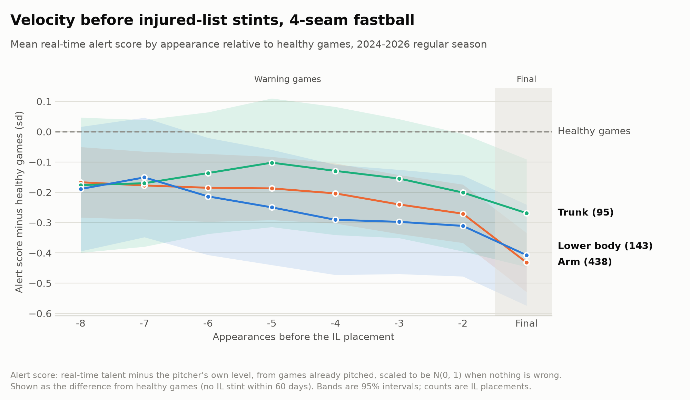
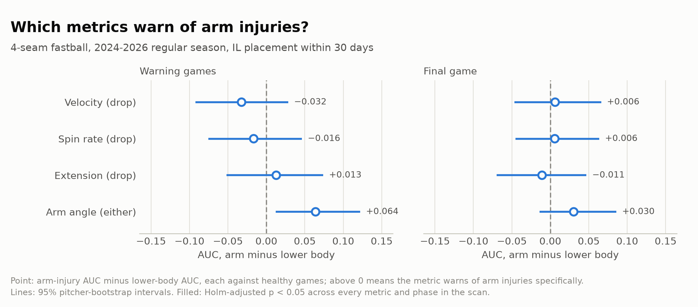
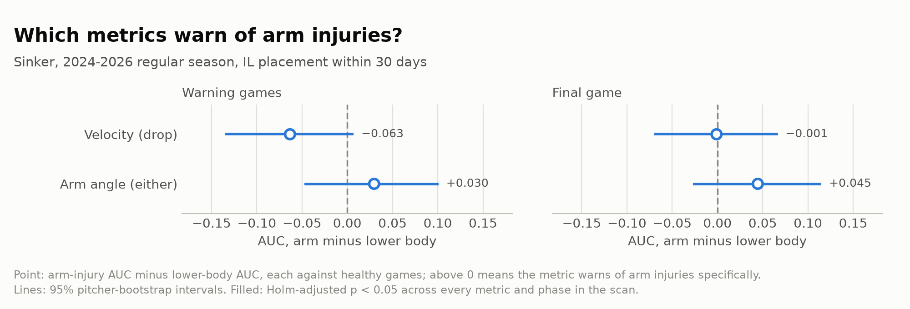

# Velocity, spin, extension and arm angle before IL stints

*statecast, October 2026*

## Summary

A drop in a pitcher's real-time fastball velocity is a modest warning that an injured-list stint is coming, but it does not point to the arm. Velocity falls just as much before back, oblique and lower-body stints. None of the four pitch-tracking metrics tested tells arm injuries apart from other injuries.

- **Velocity drops come before IL stints of every kind.** On four-seamers, the final game before a placement
separates injured pitchers from health ones with AUC 0.61 for arm stints and 0.61 for lower-body stints.
- **The drop is not arm-specific.** Arm minus lower-body AUC is -0.03 in the warning games and +0.01 in the final game on four-seamers. On sinkers it is -0.06 and 0.00.
- **Velocity adds a little beyong workload on four-seamers only.** The odds of an arm stint rise 1.17× per sd of velocity drop [1.04, 1.32], and out-of-fold AUC improves from 0.50 to 0.54. On sinkers there is no gain.
- **No metric warns of arm injuries specifically.** Velocity, spin rate, extension and arm angle were each contrasted against a lower-body placebo. Nothing survives a Holm correction. he one nominal hit (arm angle on four-seamers, +0.064, raw p = 0.028) did not replicate on sinkers.

For a front office, a velocity alert is a reason to check on a pitcher. It is not evidence about which body part is involved.

## Data

The study uses every regular-season Statcast pitch from 2024 through 2026, plus every injured-list placement in the MLB Stats API transaction feed over the same span. Each pitcher-game is reduced to the per-pitch mean and spread of one metric for one pitch type.

| Pitch type | Pitchers | Appearances | Arm stints | Trunk Stints | Lower-body stints | Other stints |
| --- | --- | --- | --- | --- | --- | --- |
| 4-seam fastball (FF) | 749 | 46,040 | 435 | 95 | 143 | 85 |
| Sinker (SI) | 426 | 27,402 | 217 | 52 | 78 | 53 |

Counts are IL placements with at least one appearance in the 30 days before them. Appearance counts are for velocity; other metrics differ by a few dozen games where tracking is missing.

**Placements.** A placement is a Status Change transaction whose text reads "place ... on the N-day injured list". When the text says "retroactive to" a date, the stint starts on that date rather than on the transaction date. This matters because the retroactive date is closer to when the pitcher stopped pitching.

**Injury groups.** The injury named in the transaction text is matched against keyword lists in order, and the first match wins:

1. **Arm:** elbow, shoulder, forearm, UCL, flexor, biceps, triceps, rotator, cuff, labrum, lat, teres, thoracic outlet.
2. **Trunk:** oblique, back, ribs, intercostal, abdominal, side, chest, neck.
3. **Lower body:** hip, groin, hamstring, quad, knee, calf, ankle, Achilles, foot.
4. **Other:** illness, concussion, hand and finger injuries, and placements with no injury named.

Lat and teres injuries count as arm because they are throwing-shoulder injuries. Thoracic outlet syndrome counts as arm because it is listed before the trunk keywords.

## Model

Each pitcher has a long-run level and a current talent that wanders around it. A game's pitches are noisy readings of that talent. A linear-Gaussian state-space model separates the three, so the filter can say at any date how far a pitcher's talent has moved from his own level an how sure it is.

For pitcher $i$ with level $\mu_i$, talent $\theta_i(t)$ follows an Ornstein-Uhlenbeck process that reverts to $\mu_i$:
$$
d\theta_i(t) = -\kappa\,(\theta_i(t) - \mu_i)\,dt + \sigma\,dW_i(t),
\qquad \mu_i \sim N(m, s^2)
$$

Appearance $k$ has $n_k$ pitches with mean $\bar y_k$. Each game adds a one-day shock shared by all its pitches (rest, weather, adrenaline), and the league shares a seasonal curve $g(\text{day})$:

$$
\bar y_k \mid \theta \sim N\!\left(\theta(t_k) + g(t_k),\; \tau^2 + r^2 / n_k\right)
$$

The seasonal curve $g$ is piecewise linear with monthly knots from April 1 to October 1, anchored at zero on July 1, so talent is quoted as its July equivalent. The state $[\theta, \mu]$ is filtered exactly with a Kalman filter and smoothed with a Rauch-Tung-Striebel pass. The within-game sum of sqaures contributes the pitch noise $r$ directly. 

All 12 population parameters ($\kappa$, $\sigma$, $r$, $m$, $s$, $\tau$ and six seasonal knots) are fitted by maximum likelihood in JAX with L-BFGS. Intervals come from the inverse Hessian. The optimizer works in units scaled by the pooled per-pitch spread, so spin rate in rpm converges as reliably as velocity in mph.


| Metric (FF) | Talent half-life (days) | Drift sd | Spread of levels | Game-day sd | Pitch sd | April vs July |
| --- | --- | --- | --- | --- | --- | --- |
| Velocity (mph) | 100 [88, 114] | 0.80 | 2.17 | 0.53 | 0.94 | −0.41 |
| Spin rate (rpm) | 86 [76, 98] | 50 | 133 | 41 | 78 | −16.8 |
| Extension (ft) | 148 [124, 177] | 0.11 | 0.39 | 0.09 | 0.12 | +0.01 |
| Arm angle (degrees) | 124 [110, 140] | 3.1 | 12.0 | 1.17 | 2.54 | +0.47 |

Drift sd is how far talen typically sits from a pitcher's own level, $\sigma / \sqrt{2\kappa}$. Spread of levels if $s$, the spread between pitchers. Drift is 12% of talent variance for velocity and spin rate, 8% for extension and 6% for arm angle. Most of what separates pitchers is permanent, which is what lets a change in one pitcher stand out.

Sinkers give nearly the same velocity fit: half-life 98 dyas, drift sd 0.84 mph. Sinker arm angle runs about +0.74 degrees high in April, against +0.47 on four-seamers.

## Alert Score

The alert score measures how far a pitcher's current talent sits from his own level, using only games already pitched. it is scaled so that it is exactly standard normal when nothing is wrong, so a threshold of -2 means the same tail probability for every pitcher, metric and point in a career.

The gap is $g = \theta - \mu$. With no data it has variance $v = \sigma*2 / (2\kappa)$. After the filter had seen a pitcher's games up to today, the posterior variance of the gap is $P_k$. In a linear-Gaussian model $P_k$ does not depend on the data, so the filtered mean $E[g \mid y]$ has marginal variance $v - P_k$, and:

$$
z_k = \frac{E[g \mid y_{1:k}]}{\sqrt{v - P_k}} \sim N(0, 1) \text{ under the model}
$$
Dividing by the posterior sd $\sqrt{P_k}$ instead would make the score far too quiet. Early in a career $P_k$ is close to $v$ and the filtered mean barely moves, so real surprises would read as small. A simulation check confirms the calibrated sacore has mean 0 and sd 1 on data drawn from the fitted model.

Each metric is scored in the direction that would be worrying:

- **Drop** (velocituy, spin rate, extension): $-z$, so a fall in talent scores high.
- **Either** (arm angle): $|z|$, because a slot change in either direction could be a compensation.

## Study Design
The central test compares arm injuries against lower-body injuries, not just
against health. A pitcher who is about to go on the IL for any reason may
already be pitching hurt, tired or carefully. A metric that falls before every
kind of stint warns of injury, but says nothing about the arm. Lower-body
stints are the placebo: if a metric is an arm signal, it should separate arm
stints from healthy games better than it separates lower-body stints.

1. **Phases.** Appearances within 30 days before a placement are positives.
   The last game before the stint is the **final game**: by then the injury
   has often already happened. The earlier games are **warning games**, the
   window in which an alert could still change a decision.
2. **Negatives.** Healthy games are every appearance with no placement in the
   next 30 days. Games before stints in other injury groups, or in the other
   phase, are left out of each comparison.
3. **AUC.** For each injury group and phase, the AUC is the chance that a
   positive game scores higher than a healthy game, with ties counted as half.
   An AUC of 0.5 means the metric carries no signal.
4. **Placebo contrast.** The test statistic is arm AUC minus lower-body AUC.
   Above 0 means the metric warns of arm injuries specifically.
5. **Uncertainty.** Pitchers are resampled with replacement 500 times, which
   keeps each pitcher's games together. Arm and lower-body AUCs are recomputed
   on the same draws, so their difference is a paired estimate. Intervals are
   bootstrap percentiles; p-values are two-sided.
6. **Multiplicity.** The scan tests four metrics in two phases, eight tests per
   pitch type. Holm's step-down correction holds the family-wise error rate at
   5%.

**Workload control.** Velocity could look predictive only because tired or
overused pitchers both throw softer and get hurt. A logistic regression of arm
stints on warning games adds velocity drop to two workload terms: pitches
thrown and days of rest, each as a z-score against the pitcher's own earlier
games. Standard errors are clustered by pitcher. Out-of-fold AUC uses five
folds split by pitcher, so no pitcher appears in both training and test data.

## Results

### Velocity falls before every kind of stint

Four-seam velocity sits about 0.2 sd below healthy games for weeks before a
placement, then drops to about 0.4 sd below in the final game. The arm and
lower-body lines move together the whole way.



| Injury group | FF warning AUC | FF final-game AUC | SI warning AUC | SI final-game AUC |
| --- | --- | --- | --- | --- |
| Arm | 0.54 [0.51, 0.58] | 0.61 [0.58, 0.64] | 0.49 [0.44, 0.53] | 0.59 [0.54, 0.63] |
| Lower body (placebo) | 0.57 [0.52, 0.63] | 0.61 [0.55, 0.66] | 0.55 [0.48, 0.62] | 0.59 [0.52, 0.65] |
| Trunk | 0.54 [0.47, 0.61] | 0.57 [0.51, 0.62] | 0.57 [0.48, 0.65] | 0.60 [0.52, 0.67] |
| Other | 0.48 [0.41, 0.54] | 0.51 [0.45, 0.57] | 0.51 [0.44, 0.59] | 0.56 [0.48, 0.64] |

Velocity drop scored against healthy games, 30-day horizon, 95%
pitcher-bootstrap intervals. The final game separates best for every physical
injury group. The "other" group, mostly illness and hand injuries, shows
little or nothing, which is what a real physical signal should look like. On
sinkers, warning games before arm stints show no drop at all (0.49).

### Velocity adds a little beyond workload, on four-seamers only

| Term (per sd) | FF odds ratio | SI odds ratio |
| --- | --- | --- |
| Velocity drop | 1.17 [1.04, 1.32] | 0.98 [0.84, 1.14] |
| Pitches vs own norm | 1.03 [0.98, 1.09] | 1.06 [0.97, 1.16] |
| Rest vs own norm | 1.03 [1.00, 1.06] | 1.01 [0.97, 1.05] |
| Out-of-fold AUC, workload only | 0.50 | 0.47 |
| Out-of-fold AUC, workload + velocity | 0.54 | 0.44 |

Arm stints in warning games, logistic regression with pitcher-clustered
intervals and five pitcher-grouped folds. Workload alone predicts nothing.
Four-seam velocity carries a small, real signal on top of it. Sinker velocity
does not.

### What an alert threshold buys

| Alert at drop of | Games flagged | Precision | Lift over base rate | Arm stints caught | Median lead (days) |
| --- | --- | --- | --- | --- | --- |
| 1.0 sd | 12.5% | 7.0% | 1.26 | 103 of 416 | 23 |
| 1.5 sd | 5.1% | 7.4% | 1.33 | 50 of 416 | 20 |
| 2.0 sd | 1.9% | 6.8% | 1.22 | 16 of 416 | 20.5 |
| 3.0 sd | 0.25% | 14.0% | 2.51 | 4 of 416 | 26.5 |

Four-seam warning games before arm stints within 30 days; the base rate is
5.6% of games. A threshold of 1 sd catches a quarter of arm stints about three
weeks ahead, at the cost of flagging one game in eight. Precision stays below
15% at every threshold, so an alert is a prompt to look, not a prediction.

### No metric is arm-specific

Four metrics in two phases on four-seamers give eight placebo contrasts. Every
interval but one crosses zero, and no Holm-adjusted p-value is below 0.22.



The one nominal result is arm angle in warning games: +0.064 [0.012, 0.122],
raw p = 0.028. It does not come from a strong arm signal. Arm angle barely
separates arm stints from healthy games (AUC 0.51); the difference comes from
lower-body stints sitting below 0.5 (AUC 0.45).

On sinkers, the arm-angle difference shrinks to +0.030 [−0.048, 0.101],
p = 0.40. Velocity on sinkers points the other way, toward lower-body stints,
though not significantly (−0.063, p = 0.08).



The intervals are narrow enough to rule out a large effect. No metric gives
arm stints an AUC advantage over lower-body stints of more than about 0.07 to
0.12.

## Limitations

The biggest limit is the outcome: an IL placement is a roster decision, not
the moment of injury. The rest are about what the design can and cannot rule
out.

- **Placement timing is noisy.** Teams choose when to place a pitcher, use the
  IL strategically, and backdate placements. Using the retroactive date helps,
  but the final game is not always the game in which the injury happened.
- **Injury groups come from transaction text.** Keyword matching misses vague
  wording, and stints with no injury named fall into "other". Misclassified
  stints would pull the arm and lower-body AUCs together, biasing the contrast
  toward zero.
- **The placebo is not inert.** A drive-leg or hip problem can plausibly cost
  velocity, as the sinker results hint. The contrast measures whether a metric
  is arm-specific, not whether it is caused by the injury.
- **The replication is partial.** Many pitchers throw both a four-seamer and a
  sinker, so the two samples share pitchers and stints.
- **Starters and relievers are pooled.** Their workloads and recovery patterns
  differ, and a signal confined to one role could be diluted.
- **Only four metrics on two pitches were tested.** Movement, release height
  and side, and breaking-ball spin are untested.
- **The model assumes smooth drift.** A sudden change, such as an injury
  mid-game, is spread over several games by the Ornstein-Uhlenbeck filter, so
  it is detected late.
- **One pattern is unexplained.** Arm angle moves less than usual before
  lower-body stints (AUC 0.45–0.49 in every cell). This study cannot say why.

## Using it, and what comes next

The calibrated alert score is ready to use as a daily screen, as long as it is
read for what it is. A velocity alert flags a pitcher whose stuff has moved
away from his own baseline. It justifies a conversation with the medical and
performance staff. It does not say where the problem is, and it should not be
used to argue that a pitcher's arm is fine or not fine.

- **Daily use.** Every pitcher's alert score updates after each outing and
  needs no tuning per pitcher, because the score is on the same N(0, 1) scale
  for everyone.
- **Season planning.** The seasonal curves are a by-product: four-seam
  velocity runs about 0.4 mph below its July level in April, and spin about
  17 rpm below. An early-season dip of that size is normal and should not
  trigger an alert, and the model already allows for it.
- **Talent estimates.** The smoothed talent curves give a noise-adjusted read
  of each pitcher's current stuff for evaluation and trades, separate from the
  injury question.

Three extensions would sharpen the alert:

1. **Jumps.** Add a jump component to the talent process and filter it with a
   Rao-Blackwellized particle filter. A sudden loss would then be flagged in
   one game instead of being spread over several.
2. **Joint metrics.** Model velocity, spin, extension and arm angle as one
   multivariate state. A drop in several metrics at once may carry information
   that none carries alone.
3. **More inputs.** Add movement, release point and breaking-ball metrics, and
   split starters from relievers, then rerun the same placebo-controlled scan.

## Reproducing

```bash
uv run statecast ingest --start 2024-03-20 --end 2026-10-17
for metric in release_speed spin_rate release_extension arm_angle; do
  uv run statecast trajectory pitcher --metric "$metric" \
    --season 2024 --season 2025 --season 2026
done
uv run statecast trajectory pitcher --pitch-type SI \
  --season 2024 --season 2025 --season 2026
uv run statecast trajectory pitcher --pitch-type SI --metric arm_angle \
  --season 2024 --season 2025 --season 2026
uv run statecast alerts --pitch-type FF
uv run statecast alerts --pitch-type SI
uv run statecast scan
uv run statecast scan --pitch-type SI
```